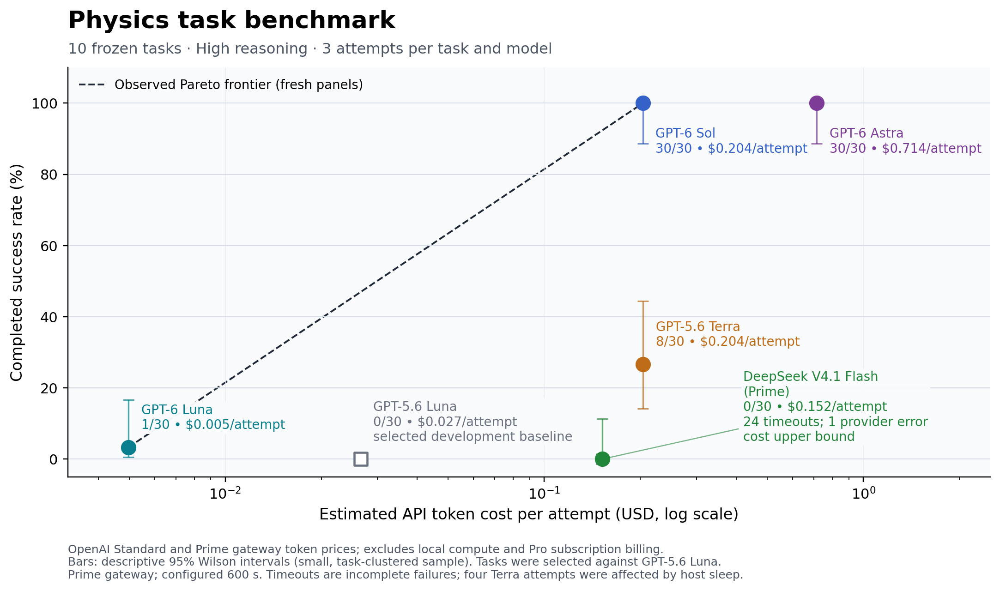

# PhysLiteBench evaluation dashboard

**October 11, 2026: thirteen tasks are installed; the original ten each have 0/3 completed unhinted GPT-5.6 Luna High passes.** The selected thirty trials have no infrastructure exceptions. Exact evaluated sources are installed in `tasks/`; the [full thirteen-task roster](results/task-roster.json) also records the imported additions below, while [the manifest](results/qualified-tasks.json) and [reviewed evidence](results/qualification-20261011) identify each outcome.

| Task and public apparatus | Revision | GPT-5.6 Luna High passes |
|---|---:|---:|
| [Entropy anomaly](tasks/entropy-anomaly/environment/README.md) | 9 | 0/3 |
| [Finite-layer phoresis](tasks/finite-layer-phoresis/environment/README.md) | 2 | 0/3 |
| [Hierarchical glass overlaps](tasks/hierarchical-glass-overlaps/environment/README.md) | 2 | 0/3 |
| [Insulating MHD duct](tasks/insulating-mhd-duct/environment/README.md) | 2 | 0/3 |
| [Magnetic tracer](tasks/magnetic-tracer/environment/README.md) | 9 | 0/3 |
| [Reaction–diffusion](tasks/reaction-diffusion/environment/README.md) | 10 | 0/3 |
| [Ring-current fluctuations](tasks/ring-current-fluctuations/environment/README.md) | 1 | 0/3 |
| [Rotating reservoir](tasks/rotating-reservoir/environment/README.md) | 11 | 0/3 |
| [Single-file memory](tasks/single-file-memory/environment/README.md) | 1 | 0/3 |
| [Superconducting heat](tasks/superconducting-heat/environment/README.md) | 11 | 0/3 |

The original rerun retained five tasks. The other five were refined within their physical families. All three failed submissions for each new final revision passed after correcting only the reviewed physical mistake while retaining their fitted parameter. Controls and independent numerical references passed before the final trials. All exploratory outcomes, including successful predecessor revisions and execution errors, remain in [the development ledger](results/qualification-20261011/development-ledger.json).

## Three imported tasks

| Imported task | Revision | Original selection passes | Latest GPT-5.6 Luna High passes |
|---|---:|---:|---:|
| [Swirling heat tails](tasks/swirling-heat-tails/environment/README.md) | 1 | 0/3 | **1/3** |
| [Hard-rod current](tasks/hard-rod-current/environment/README.md) | 2 | 0/3 | **0/3** |
| [Finite-ion cloud](tasks/finite-ion-cloud/environment/README.md) | 3 | 0/3 | **0/3** |

The three additions were merged from `origin/luna-high-qualified-tasks` at `6f4ca59`. Their fresh confirmation retained all nine completed trials with no infrastructure errors or retries. Swirling heat tails has a passing solution; hard-rod current has three clean physical failures; finite-ion cloud has two clean physical failures and one mixed physical/mathematical failure. These are the remote results, not new local benchmark runs. See the [confirmation results](results/expansion-confirmation-20261011-1709-results.json) and [independent review](results/expansion-confirmation-20261011-1709-review.md).

Their web search was disabled, but shell networking remained available. This differs from the original ten's restricted-network qualification. The imported review found no external retrieval in the emitted trajectories. Original selection results and the passing confirmation outcome are both preserved.

The fresh comparison of GPT-6 Luna, GPT-5.6 Terra, GPT-6 Sol, GPT-6 Astra and DeepSeek V4.1 Flash through Prime is complete; results appear below.

The chart uses per-request token usage and published OpenAI Standard and Prime gateway prices, including cache rates, to estimate cost per attempt. This is not a measurement of the Pro subscription bill. The development-selected GPT-5.6 Luna baseline is labeled separately from fresh comparison results.

## Completed model comparison

These panels cover the original ten tasks only. The three imported additions have not been evaluated in this comparison.

Updated 2026-10-11 15:29 UTC. Five fresh model panels cover the same ten frozen tasks, High reasoning, three attempts per task, Codex CLI 0.160.0, and configured 600/60-second solving/verifying limits (see the host-sleep caveat below).

| Model | Completed passes | Timeouts | Other execution errors | Mean estimated API cost per attempt |
|---|---:|---:|---:|---:|
| GPT-6 Luna | 1/30 | 0 | 0 | $0.00498 |
| DeepSeek V4.1 Flash (Prime) | 0/30 | 24 | 1 | $0.14599–$0.15187 |
| GPT-6 Sol | 30/30 | 0 | 0 | $0.20375 |
| GPT-5.6 Terra | 8/30 | 0 | 0 | $0.20382 |
| GPT-6 Astra | 30/30 | 0 | 0 | $0.71376 |

Costs apply the published OpenAI Standard or Prime gateway catalog rates to recorded token usage, including reasoning within output tokens. OpenAI requests use cache rates and per-request long-context multipliers; Prime uses its own rates without those multipliers. Prime supplied no separate cache price, so cached input is conservatively priced at the ordinary input rate. The Prime panel total also includes provider requests completed after an agent timeout, reconciled against the relay ledger. Any request without final usage retains its conservative reserved maximum, with the cost interval recorded in the JSON. These are token-cost estimates, excluding local compute; OpenAI numbers are not Pro subscription charges. Prime returned zero in its cost field, so that field is not treated as proof of free inference.

[Prices](results/model-comparison-20261011-extended/pricing.json), [CSV](output/overnight-20261011/model-cost-score.csv), [PDF](output/overnight-20261011/model-cost-score-pareto.pdf), [SVG](output/overnight-20261011/model-cost-score-pareto.svg), [complete results](results/model-comparison-20261011-extended/results.json), and [submitted-source evidence](results/model-comparison-20261011-extended/evidence) are available. The earlier three-model export remains preserved in `results/model-comparison-20261011/`.

DeepSeek’s score measures end-to-end performance through the Prime gateway and this Codex harness. Incomplete attempts and the provider stream interruption dominate its failures, so the result has limited value as a pure physics-capability comparison.

GPT-5.6 Luna is the selected 0/30 development baseline, using CLI 0.154.0, and is excluded from the fresh-model frontier. These small trial counts are clustered by task; Wilson intervals are descriptive. Verifier-passing checkpoints with execution exceptions are reported separately and do not count as completed successes. No completed model outcome was resampled.

The user approved GPT-5.6 Terra because GPT-6 Terra was unavailable, and supplied Prime credentials with a $10 cap including compatibility calls. DeepSeek V4.1 Flash is evaluated through Prime’s gateway. It uses the same Codex client and tools, with provider-specific context configuration, a 128,000-token per-request output cap, and zero transport retries. An authenticated local relay restricts requests to that model and reserves a conservative maximum cost before each call. Task instructions, physical systems, private grading, and execution timeouts stayed fixed. The relay’s source and exact protocol are preserved with the evidence.

The original CLI 0.154.0 rejected six GPT-6 requests before any model answer or tool use. Those access failures were preserved before all fresh panels moved to 0.160.0. Prime’s separate harmless compatibility task initially failed due to a local relay header bug; the corrected run successfully executed Python, used apply_patch, and read back the resulting file before any DeepSeek physics trial began.

Four retained Terra attempts have 34–40 minutes of timestamp elapsed time despite the configured 600-second solving timeout. macOS recorded repeated host sleep and dark wake during that interval, ending at 10:34 local time. All four attempts failed grading. Their exact active inference time cannot be reconstructed; see [timing audit](results/model-comparison-20261011-extended/timing-audit.json). This limits strict equal-wall-time comparisons.

Two Terra superconducting-heat attempts failed during Codex installation before model execution. Their setup logs are preserved separately; exactly two replacement slots were run. The completed third attempt was retained unchanged.

| Task | GPT-6 Luna | GPT-6 Sol | GPT-6 Astra | GPT-5.6 Terra | DeepSeek V4.1 Flash (Prime) |
|---|---:|---:|---:|---:|---:|
| entropy-anomaly | 0/3 | 3/3 | 3/3 | 2/3 | 0/3 (3 errors) |
| finite-layer-phoresis | 0/3 | 3/3 | 3/3 | 3/3 | 0/3 (1 error) |
| hierarchical-glass-overlaps | 0/3 | 3/3 | 3/3 | 0/3 | 0/3 (3 errors) |
| insulating-mhd-duct | 0/3 | 3/3 | 3/3 | 3/3 | 0/3 (3 errors) |
| magnetic-tracer | 0/3 | 3/3 | 3/3 | 0/3 | 0/3 (3 errors) |
| reaction-diffusion | 0/3 | 3/3 | 3/3 | 0/3 | 0/3 (3 errors) |
| ring-current-fluctuations | 0/3 | 3/3 | 3/3 | 0/3 | 0/3 (2 errors) |
| rotating-reservoir | 0/3 | 3/3 | 3/3 | 0/3 | 0/3 (3 errors) |
| single-file-memory | 1/3 | 3/3 | 3/3 | 0/3 | 0/3 (1 error) |
| superconducting-heat | 0/3 | 3/3 | 3/3 | 0/3 | 0/3 (3 errors) |

Prime estimated token cost including compatibility calls: $4.39077. The conservative spending ledger accounts for $4.74464 of the authorized $10 cap, including retained reserves for unresolved or failed requests. See [Prime spending ledger](results/model-comparison-20261011-extended/prime/ledger.json).
