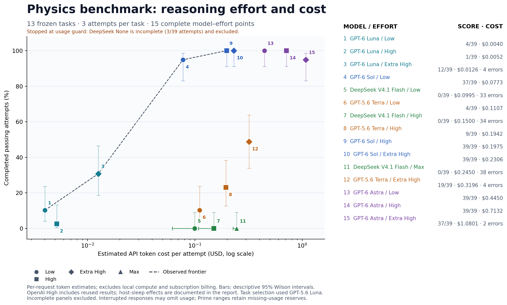

# Reasoning-effort comparison

Updated 2026-10-13T06:32:50.028112+00:00. Each complete point covers 13 frozen tasks and 39 attempts. All settings use the same Codex 0.160.0 client and 600/60-second agent/verifier limits.

| Model | Effort | Status | Recorded attempts | Completed passes | Passing checkpoints | Errors | Mean estimated API cost |
|---|---|---|---:|---:|---:|---:|---:|
| GPT-6 Luna | Low | Complete | 39/39 | 4 | 4 | 0 | $0.00402 |
| GPT-6 Luna | High | Complete | 39/39 | 1 | 1 | 0 | $0.00517 |
| GPT-6 Luna | Extra High | Complete | 39/39 | 12 | 13 | 4 | $0.01261 |
| GPT-6 Sol | Low | Complete | 39/39 | 37 | 37 | 0 | $0.07733 |
| GPT-6 Sol | High | Complete | 39/39 | 39 | 39 | 0 | $0.19754 |
| GPT-6 Sol | Extra High | Complete | 39/39 | 39 | 39 | 0 | $0.23061 |
| GPT-5.6 Terra | Low | Complete | 39/39 | 4 | 4 | 0 | $0.11071 |
| GPT-5.6 Terra | High | Complete | 39/39 | 9 | 9 | 0 | $0.19419 |
| GPT-5.6 Terra | Extra High | Complete | 39/39 | 19 | 20 | 4 | $0.31963 |
| GPT-6 Astra | Low | Complete | 39/39 | 39 | 39 | 0 | $0.44501 |
| GPT-6 Astra | High | Complete | 39/39 | 39 | 39 | 0 | $0.71323 |
| GPT-6 Astra | Extra High | Complete | 39/39 | 37 | 39 | 2 | $1.08014 |
| DeepSeek V4.1 Flash | High | Complete | 39/39 | 0 | 0 | 34 | $0.15004 |
| DeepSeek V4.1 Flash | Low | Complete | 39/39 | 0 | 0 | 33 | $0.09954 |
| DeepSeek V4.1 Flash | Max | Complete | 39/39 | 0 | 0 | 38 | $0.24497 |
| DeepSeek V4.1 Flash | None | Partial | 3/39 | 0 | 0 | 1 | — |

This delivery stops at the conservative account-usage guard, with 15 complete comparison points and 588 primary observations. Astra Extra High is complete: 37/39 completed passes, 39 passing checkpoints, two timeouts. DeepSeek Low, High and Max each have 39 attempts and zero completed passes, with 33, 34 and 38 execution errors respectively. DeepSeek None has 3/39 attempts (zero passes, one timeout); its remaining 36 attempts were not run and its incomplete panel is excluded from the plot. The full planned 16-point sweep is not complete. All started outcomes, the 48 legacy observations and six unstarted setup failures remain preserved.

[Final run status and budget decision](run-status.json).

Only complete panels with reconciled costs enter the frontier. Missing attempts are not treated as failures. Execution errors remain recorded and are reported separately. The main score counts a pass only when the agent finishes without an exception; passing saved checkpoints after a timeout are also listed, without changing that predefined score. Low and Extra High are fresh runs; OpenAI High reuses 30 matching observations per model from the original ten-task comparison and adds nine observations on the new tasks.

Costs are API-equivalent token estimates, not Pro subscription charges. Task selection against GPT-5.6 Luna and reuse of the original High observations are disclosed. Four historical Terra High trials were affected by host sleep; see the prior comparison timing audit. The selected GPT-5.6 Luna baseline remains in the old ten-task plot and is excluded from this thirteen-task frontier.

[Frozen plan](plan.json), [results](results.json), [CSV](summary.csv), [pricing](pricing.json), [evidence audit](evidence-audit.json), [task-source audit](task-source-audit.json), [final audit](final-audit.json), and [plot reproduction](REPRODUCE.md). [Per-task scores](per-task-scores.csv), [trial outcomes](trial-outcomes.csv), and [model inventory](model-inventory.json) provide the detailed counts.

Provider errors are execution failures. Token estimates may omit usage from interrupted responses; inspect the [saved reviews](reviews/) before treating small cost differences as meaningful.

The October 12 continuation adds Astra Extra High and a fresh DeepSeek cohort at None, Low, High and Max. All earlier observations are preserved. The user removed the Prime spending cap and waived the earlier account ceiling for the full Astra panel. See [authorization](continuation-20261012.json). DeepSeek Max uses Codex’s xhigh transport setting, translated to provider Max by the relay; both settings are verified in the request ledger. The provider’s none setting is labeled None. The fresh DeepSeek cohort uses [cache-aware current catalog rates](prime/pricing-v2.json) and retains conservative reserves for missing usage. A reproduced 15-second response-header limit in the network sidecar affected the legacy relay; see the [transport correction](prime/transport-v2-amendment.json). All 48 [legacy DeepSeek observations](prime/legacy-transport-results.json) remain separate from the new four-effort cohort.

Six setup attempts were interrupted by host sleep and network failures before model execution, grading or any saved native model session. They remain in the [unstarted-setup recovery record](unstarted-setup-recovery-20261012.json); their six replacements were declared before launch. Primary points count 39 started model attempts. No started or scored outcome was replaced.

Three started DeepSeek High attempts on superconducting heat overlapped closed-lid host sleep and ended in connection failures. Their original outcomes and abnormal elapsed times remain in the primary data; they were not replaced. See the [timing reviews](timing-flag-reviews.json). These execution failures do not establish physics mistakes.

[PDF](../../output/reasoning-sweep-20261011/pareto-reasoning.pdf) · [SVG](../../output/reasoning-sweep-20261011/pareto-reasoning.svg)
